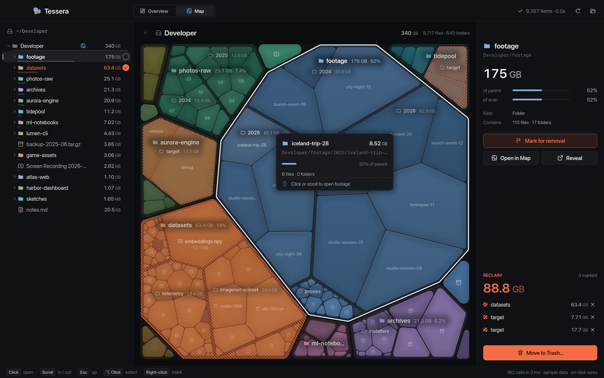
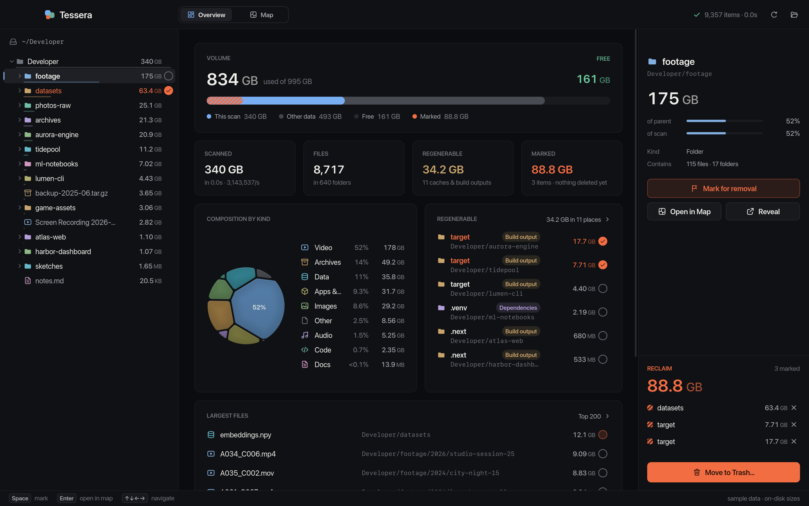

# Tessera

See where your disk went, and take it back.

Tessera scans a folder very quickly, shows sizes as a **nested Voronoi map**
(convex cells whose area matches the bytes on disk), and lets you mark things
for removal and then move them to the Trash in one confirmed step.




## Highlights

- **Fast scanning**: bulk `getattrlistbulk(2)` calls, parallel workers that never
  wait for each other, and a single thread that writes results. `~/.cargo`
  (34k entries) takes 36 ms on an M1, 3× faster than `du`. Results stream in
  while the scan runs.
- **Voronoi treemap**: power diagrams following Nocaj–Brandes. Each level is
  solved in parallel and reuses the previous layout as its starting point, so
  live updates morph smoothly. Click or scroll to open a region one level
  deeper. The old map dives into the cell while the new one grows out of it.
  Scrolling back or pressing Esc pulls back out. Labels scale with the room
  their cell has, so the map labels itself.
- **Context everywhere**: colours follow the hierarchy, so the tree and the map
  always agree. The tree pins the ancestors of what you are looking at, lights
  the indent guide around the selection, and shows the map's current scope
  as a band.
- **GPU UI**: winit + wgpu + glyphon. Shapes are drawn as exact SDF rounded
  rects and convex polygons. The icons are our own vector paths, rasterised
  into the glyph atlas. There are three draw layers, and nothing redraws while
  idle (0% CPU).
- **Safe by design**: marking only builds a plan, regenerable content is
  pointed out but never marked for you, items only go to the Trash, and
  privacy-protected folders are skipped instead of triggering OS prompts.

## Run

```sh
cargo run --release                 # scans $HOME
cargo run --release -- ~/Projects   # scans a folder
cargo run --release -- --sample        # fictional data: safe for demos and screenshots
cargo run --release -- --sample --snapshot out.png --view map   # headless PNG
```

| Input | Action |
|-------|--------|
| Click, scroll up or pinch out in the map | open that region one level deeper (zoom) |
| Scroll down or pinch in in the map | up one level |
| ⌥-click in the map | select the exact entry |
| Click / ↑↓←→ / PgUp PgDn / Home End | select and navigate the tree |
| Double-click a folder in the tree, Enter | show it in the map |
| Right-click, Space, M | mark / unmark |
| Esc, Backspace, mouse back | map: up one level |
| ⌘1 / ⌘2 | Overview / Map |
| ⌘⌫ | review and move marked items to the Trash |
| ⌘R / ⌘O | rescan / open another folder |

## Architecture

The code follows DDD with one crate per layer (see [ADR-0002](docs/adr/0002-layered-hexagonal-workspace.md)).

| crate | layer | contents |
|-------|-------|----------|
| `tessera-domain` | domain | `Inventory` and `ReclaimPlan` aggregates, `Category`, `ReclaimHint`, `Insights`; no dependencies |
| `tessera-voronoi` | domain kernel | polygons, power diagrams, the treemap solver; no dependencies |
| `tessera-app` | application | ports, `ScanSession`, `Cartographer`, commit use case, `Workspace` façade |
| `tessera-infra` | infrastructure | bulk and portable readers, Trash, `statvfs`, Full Disk Access probe |
| `tessera-ui` | presentation | renderer, immediate-mode UI, views, composition root (`main.rs`) |

- Decisions: [`docs/adr/`](docs/adr/README.md)
- Domain: [ubiquitous language](docs/domain/ubiquitous-language.md), [context map](docs/domain/context-map.md)
- Contributor rules: [`AGENTS.md`](AGENTS.md)

Diagnostics: `cargo run -p tessera-infra --release --example scan -- <dir> [portable]`,
`--example slowdirs -- <dir>`, `cargo run -p tessera-voronoi --release --example bench`.

Screenshots in this README use `--sample`, a fictional folder.

Platform: macOS (Apple Silicon tested). Readers and the Trash are behind
ports, and a portable `readdir` reader is included for other Unix systems.

## License

MIT, see [LICENSE](LICENSE).
